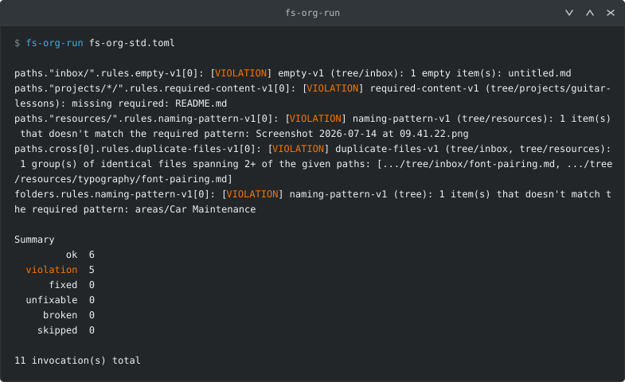
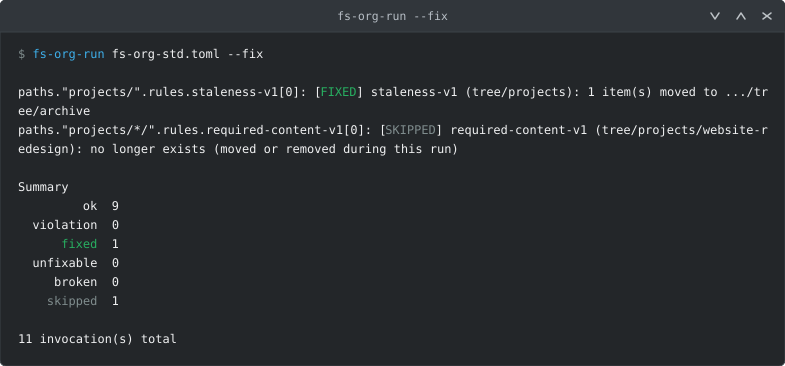

#  fs-org-kit


**A standard for how your files should be organized, made machine-enforceable.**

You write down how a directory tree *should* be organized - as data, in
one TOML file, not as a wiki page you'll stop maintaining. From that one
file you get two things: documentation you didn't have to write, and
checks that actually run.



<sub>The bundled example - a small PARA tree with five deliberate
mistakes in it, no two of them found the same way, and the standard that
catches them all.</sub>

- [What it does](#what-it-does)
- [Quick start](#quick-start)
- [How a standard is put together](#how-a-standard-is-put-together)
- [Rules](#rules)
- [Commands](#commands)
- [Documentation](#documentation)

---

## What it does

### 1. You describe the tree. It writes the documentation.

Every folder you care about gets an entry saying what it's for, what it
isn't for, and how it behaves over time:

```toml
[paths."projects/*/"]
purpose = "One project: its notes, its files, and a README stating what 'done' means."
use_for = ["working files for this project only"]
not_for = ["reference material that outlives the project"]

[paths."projects/*/".group]
lifecycle = "temporary"
origin = ["self"]
```

`fs-org-doc` turns the whole file into a Markdown document - a table of
contents, a section per folder, and a section per rule listing
everywhere it's attached and why:

> ### `projects/*/`
>
> | Field | Value |
> |---|---|
> | Purpose | One project: its notes, its files, and a README stating what 'done' means. |
> | Lifecycle | `temporary` |
> | Origin | `self` |
>
> **Use for:**
>
> - working files for this project only
>
> **Attached rules:**
>
> | Rule | Reason |
> |---|---|
> | `required-content-v1` | a project without a written definition of done drifts into being an area |

The document is generated from the *resolved* standard, so a folder that
inherits its description from another shows the real text rather than a
blank. Regenerate it whenever the standard changes and it can't go
stale - which is the whole point, since a hand-written version of this
is exactly the document everybody stops updating.

`projects/*/` above is a glob: one entry covering every project folder
you have now and every one you add later.

### 2. You attach rules. It runs them.

A rule is a small script that checks one specific thing - a naming
convention, a staleness threshold, a size limit. You attach one to a
path and say why:

```toml
[[paths."projects/".rules.staleness-v1]]
reason = "a project nobody has touched in three months is finished or abandoned - either way it belongs in archive/"

[paths."projects/".rules.staleness-v1.params]
mode = "stale"
threshold = "90d"
destination = "archive"
```

`fs-org-run` resolves every attachment and runs it against the real
filesystem. Each line of output names the attachment that produced it,
so you can go straight to the block of TOML responsible.

Some rules can also fix what they find. Here the five mistakes above
have been dealt with by hand, and one project has since gone quiet -
`--fix` archives it:



That `SKIPPED` line follows from a fixer moving a folder mid-run: the
work is planned up front from the tree as it was, and `projects/*/` had
already matched a folder that was gone by the time its turn came. A skip
isn't a failure, and a second run reports the true state.

Plenty of rules deliberately ship *without* a fixer. Whether a badly
named file should be renamed or refiled, and what a missing README
should say, are decisions a script has no business making.

Exit status is 0 when clean, 1 on a violation, 2 if the standard itself
doesn't validate - so this drops into a git hook or CI unchanged.

---

## Quick start

### 1. Install

```bash
python -m venv .venv
source .venv/bin/activate
pip install -e ".[dev]"
```

A virtualenv isn't required, but the runner invokes every rule script
with the interpreter it's running under, so whatever environment you
install into is also where a rule's dependencies need to live.

### 2. Watch it work on the example

The example is a toy tree that ships with five mistakes in it, so the
first run has something to say. Nothing here touches anything outside
the example directory.

```bash
cd examples/para
fs-org-validate fs-org-std.toml     # check the standard itself - reads no filesystem
fs-org-run      fs-org-std.toml     # check the tree against it
fs-org-doc      fs-org-std.toml     # print the generated documentation
```

That's the output in the screenshot above. No two of those five mistakes
are found the same way - one rule on a path, one on a glob, one blanket
rule over every folder on disk, and one asking about two paths at once.
[`examples/para/README.md`](examples/para/README.md) walks the rest of
the way, fixing them by hand and then letting `--fix` handle one for
you.

### 3. Point it at a directory of your own

Make a directory to hold your standard, and put this in
`fs-org-std.toml`. It's a complete, valid standard - one folder, one
rule:

```toml
root = "~/Documents/"

[meta]
schema_version = "2.1"
standard_version = "1.0"
schema_date = 2026-08-13
standard_date = 2026-08-13

[paths]

# A standard names its own fields. These are yours; nothing is built in.
[paths.attributes]
names = ["purpose", "use_for", "not_for"]
required = ["purpose"]

[paths."screenshots/"]
purpose = "Screenshots, renamed to say what they show."
not_for = ["anything you'd look for by name later"]

[[paths."screenshots/".rules.naming-pattern-v1]]
reason = "a screenshot named by the OS is unfindable a week later"

[paths."screenshots/".rules.naming-pattern-v1.params]
pattern = '^[a-z0-9]+(-[a-z0-9]+)*(\.[a-z0-9]+)?$'
mode = "allow"

[folders]

[enums]
```

Then:

```bash
fs-org-validate fs-org-std.toml     # 0 errors before you touch anything
fs-org-run      fs-org-std.toml     # what's actually wrong under ~/Documents/screenshots
fs-org-doc      fs-org-std.toml --output standard.md
```

Nothing is written to your tree unless you pass `--fix`, and only rules
that ship a fixer act even then. A cataloged path that isn't on disk is
skipped silently, so you can describe folders before you create them.

Start with one folder you already care about rather than cataloging
everything at once, and add entries as the annoyances come up.

### 4. Keep your own rules beside it

When a bundled rule doesn't cover something, write one. Rules are
discovered automatically from two directories sitting next to your
standard:

```
my-standard/
  fs-org-std.toml        your standard
  rules.own/             your own rules, merged in automatically
    my-rule-v1/
      my-rule-v1.toml
      my-rule-v1-check.py
  rules.external/        someone else's - opt-in with --include-external, never merged by default
```

[`doc/RULES.md`](doc/RULES.md) is the authoring guide, and
`rules/_template-single-v1/` is a complete working rule to copy.

---

## How a standard is put together

The grammar lives in
[`fs-org-std.template.toml`](fs-org-std.template.toml), which is
annotated throughout. The top-level tables:

| Table | What it is |
|---|---|
| `root` | the directory this standard governs |
| `meta` | schema and standard versions - see [doc/VERSIONING.md](doc/VERSIONING.md) for how the two relate, and deliberately don't |
| `paths` | specific, individually documented locations, keyed by path relative to `root` |
| `folders` | rules that apply without being tied to one cataloged path, and reserved folder *names* (like `_archive`) that mean the same thing wherever they appear |
| `tags` | closed vocabularies for metadata carried by things on disk |
| `abbreviations` | shorthand used throughout the standard |
| `enums` | closed value sets for fields that need one |

A path key is normally relative to `root`, but doesn't have to be:
`"/etc/nginx/"`, `"~/.config/"` and `"../sibling/"` each name exactly
where they say, and rules attached to them run there.

Two things worth knowing early, because they shape everything else:

- **No field name is built in.** `purpose`, `lifecycle`, `origin` are
  names the example standard chose, declared under `[paths.attributes]`.
  Yours can be different, and no part of the tool behaves differently
  because of what a field is called.
- **`reason` is required at every attachment.** It's never inherited
  from the rule or defaulted, which forces you to say why *this* rule
  belongs on *this* path - and leaves you something to read when you
  come back in a year and wonder.

An entry can also inherit any of its parts from another entry, which is
how "the same thing, at rest" folders stay in sync - see
[doc/DESIGN.md](doc/DESIGN.md).

---

## Rules

A rule is a directory: a manifest and one or two scripts, versioned
independently of any standard that uses it. This repo ships
twenty bundled rules.

| | |
|---|---|
| **Naming** | `naming-pattern` · `timestamp-format` · `timestamp-consistency` · `spelling-abbreviations` · `basename-sync` |
| **Content and type** | `file-extensions` · `mime-type` · `required-content` · `link-policy` · `link-integrity` |
| **Size and shape** | `file-size` · `folder-structure` · `empty` · `duplicate-files` |
| **Lifecycle** | `staleness` · `transfer` · `changed-since` · `uncataloged-reserved` |
| **Desktop integration** | `xdg-auto-folder-icon` · `xdg-inherit-folder-icon-color` |

Names are shown without their version suffix; you attach
`naming-pattern-v1`, not `naming-pattern`. The suffix is part of a
rule's identity rather than a revision marker, so a `-v2` that changes
behaviour lives beside the `-v1` still in use instead of replacing it.

Each lives in [`rules/`](rules/) with its manifest, its scripts, and its
own tests, so a rule stays self-contained if you copy it into your
`rules.own/`.

A few things that follow from rules being separate programs rather than
plugins:

- **They run as plain subprocesses**, never imported. A broken rule
  can't take the runner down, its dependencies are its own, and you can
  debug one directly on the command line without a standard, a validator
  or a runner in the way.
- **They run inside a sandbox** that blocks network access, starting
  other processes, and writing anywhere the invocation isn't entitled to
  touch. A checker can't write at all. This is a guard against
  accidents, not a security boundary - `--no-sandbox` turns it off.
- **A rule that caches doesn't choose where.** The core owns that, so
  everything stays inventoried and clearable in one place
  (`fs-org-cache --list` / `--clear`), which matters because
  `pip uninstall` won't clean it up for you.

**[doc/RULES.md](doc/RULES.md)** is the full authoring guide: the
manifest schema, the runner↔script protocol, the sandbox, caching, trust
tiers, and a worked example.

---

## Commands

Installed by `pip install -e .`, or run any of them as
`python -m fs_org_kit.<module>` without installing. Each takes `--help`.

| Command | Does |
|---|---|
| `fs-org-validate` | checks a standard against the grammar and its own lint rules. Reads no filesystem |
| `fs-org-run` | runs every attached rule against the real tree; `--fix` invokes fixers where they exist |
| `fs-org-doc` | generates Markdown documentation from the standard |
| `fs-org-cache` | lists and clears the on-disk cache a few rules keep between runs |

The file being checked can be named anything - nothing in the tooling
assumes the literal name `fs-org-std.toml`.

---

## Documentation

| | |
|---|---|
| [doc/RULES.md](doc/RULES.md) | writing a rule, and the runner↔script protocol |
| [doc/DESIGN.md](doc/DESIGN.md) | why things are built this way, including decisions already reverted once |
| [doc/VALIDATOR_SPEC.md](doc/VALIDATOR_SPEC.md) | what the validator checks, and the validate/lint split |
| [doc/VERSIONING.md](doc/VERSIONING.md) | schema version vs. standard version vs. rule version |
| [doc/TESTING.md](doc/TESTING.md) | test layout and what's covered |
| [doc/CHANGELOG.md](doc/CHANGELOG.md) | what changed and when |
| [doc/BACKLOG.md](doc/BACKLOG.md) | what's known to be missing |

Licensed under the [MIT License](LICENSE).
