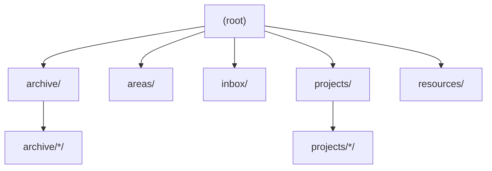
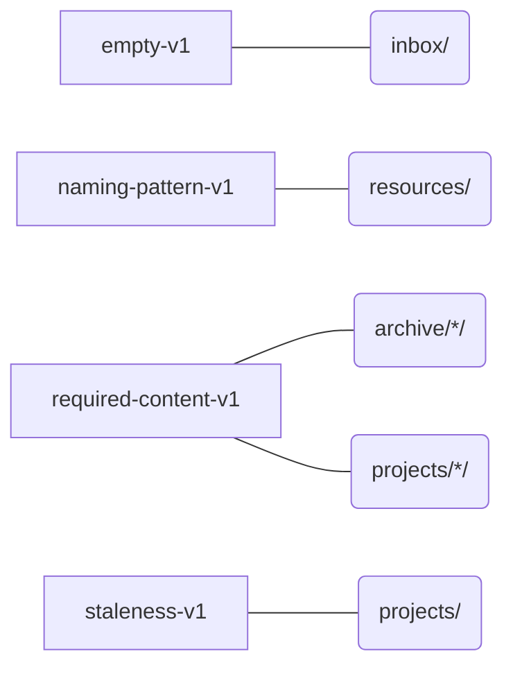
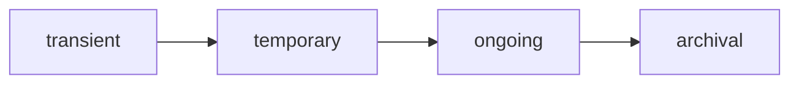

# tree - fs-org-std

> Generated from `fs-org-std.toml` - standard v1.0, schema v1.0

## Table of Contents

- [Overview](#section-overview)
- [Paths](#section-paths)
  - [`archive/`](#path-archive)
  - [`archive/*/`](#path-archive)
  - [`areas/`](#path-areas)
  - [`inbox/`](#path-inbox)
  - [`projects/`](#path-projects)
  - [`projects/*/`](#path-projects)
  - [`resources/`](#path-resources)
- [Rules](#section-rules)
  - [`empty-v1`](#rule-empty-v1)
  - [`naming-pattern-v1`](#rule-naming-pattern-v1)
  - [`required-content-v1`](#rule-required-content-v1)
  - [`staleness-v1`](#rule-staleness-v1)
- [Enums](#section-enums)

## Overview

- **Root**: `./tree/`
- PARA (Projects / Areas / Resources / Archive) plus an inbox, as an enforceable standard.
- **Schema version**: 1.0 (2026-08-05)
- **Standard version**: 1.0 (2026-08-11)
- **Cataloged paths**: 7
- **Cross-path sets**: 0
- **Reserved folders**: 0

**Path hierarchy:**

## Paths

### `archive/`

| Field | Value |
|---|---|
| Purpose | Everything from the other three categories that is no longer active - kept, not deleted. |
| Lifecycle | [`archival`](#section-enums) |
| Origin | `self` |

**Use for:**
- finished or abandoned projects
- areas you no longer maintain

**Not for:**
- anything you still expect to touch this month

### `archive/*/`

| Field | Value |
|---|---|
| Purpose | One project: its notes, its files, and a README stating what 'done' means. *(inherited from `projects/*/`)* |
| Lifecycle | [`archival`](#section-enums) |
| Origin | `self` *(inherited from `projects/*/`)* |

**Use for:**
- working files for this project only

**Not for:**
- reference material that outlives the project - move it to resources/ when you finish

**Attached rules:**

| Rule | Reason | Params |
|---|---|---|
| [`required-content-v1`](#rule-required-content-v1) *(inherited from `projects/*/`)* | a project without a written definition of done drifts into being an area | `required=["README.md"]` |

### `areas/`

| Field | Value |
|---|---|
| Purpose | Ongoing responsibilities with a standard to maintain and no finish line - health, finances, the car. |
| Notes | The PARA distinction that does the most work: an area is never 'done'. If it can be finished, it belongs in projects/. |
| Lifecycle | [`ongoing`](#section-enums) |
| Origin | `self` |

**Use for:**
- a responsibility you hold indefinitely

**Not for:**
- anything with a deadline or a definition of done

### `inbox/`

| Field | Value |
|---|---|
| Purpose | Landing zone for anything not yet filed - scans, downloads, half-written notes. |
| Notes | Not part of canonical PARA, but a common addition: without it, filing pressure lands on the four real categories. |
| Lifecycle | [`transient`](#section-enums) |
| Origin | `external`, `self` |

**Use for:**
- anything you haven't decided about yet

**Not for:**
- anything you've already decided about

**Attached rules:**

| Rule | Reason | Params |
|---|---|---|
| [`empty-v1`](#rule-empty-v1) | a zero-byte file in the inbox is a failed download, not something waiting to be filed | `check_folders=false` |

### `projects/`

| Field | Value |
|---|---|
| Purpose | Short-term efforts with a definition of done and (usually) a deadline. |
| Lifecycle | [`temporary`](#section-enums) |
| Origin | `self` |

**Use for:**
- anything you can finish

**Not for:**
- standing responsibilities - those are areas/
- reference material - that's resources/

**Attached rules:**

| Rule | Reason | Params |
|---|---|---|
| [`staleness-v1`](#rule-staleness-v1) | a project nobody has touched in three months is finished or abandoned - either way it belongs in archive/ | `mode="stale"`, `threshold="90d"`, `destination="archive"` |

### `projects/*/`

| Field | Value |
|---|---|
| Purpose | One project: its notes, its files, and a README stating what 'done' means. |
| Lifecycle | [`temporary`](#section-enums) |
| Origin | `self` |

**Use for:**
- working files for this project only

**Not for:**
- reference material that outlives the project - move it to resources/ when you finish

**Attached rules:**

| Rule | Reason | Params |
|---|---|---|
| [`required-content-v1`](#rule-required-content-v1) | a project without a written definition of done drifts into being an area | `required=["README.md"]` |

### `resources/`

| Field | Value |
|---|---|
| Purpose | Topics of ongoing interest - reference material that belongs to no single project. |
| Lifecycle | [`ongoing`](#section-enums) |
| Origin | `self`, `external` |

**Use for:**
- notes, clippings and references you'll want again

**Not for:**
- anything you're actively working on

**Attached rules:**

| Rule | Reason | Params |
|---|---|---|
| [`naming-pattern-v1`](#rule-naming-pattern-v1) | reference material is only findable if it is named for what it contains | `pattern="^[a-z0-9]+(-[a-z0-9]+)*(\.[a-z0-9]+)?$"`, `mode="allow"` |

## Rules

### `empty-v1`

Reports zero-byte files and empty folders under a path - leftovers from an interrupted download, a failed export, or a folder whose contents were moved out and never cleaned up.

| | |
|---|---|
| Tier | bundled |
| Version | 1.0 |
| Severity | `warn` |
| Scope | `single` |
| Fixable | no |

**Params:**

| Name | Default | Required |
|---|---|---|
| `check_files` | `true` | no |
| `check_folders` | `true` | no |
| `recursive` | `true` | no |
| `exclude` | `[]` | no |
| `folder_empty_means` | `"no_entries"` | no |

**Attached at 1 location(s):**

- [`inbox/`](#path-inbox) - a zero-byte file in the inbox is a failed download, not something waiting to be filed

### `naming-pattern-v1`

Checks file and/or folder names against a regular expression - either every name must match it (allow), or no name may match it (disallow).

| | |
|---|---|
| Tier | bundled |
| Version | 1.0 |
| Severity | `warn` |
| Scope | `single` |
| Fixable | no |

**Params:**

| Name | Default | Required |
|---|---|---|
| `pattern` |  | yes |
| `mode` |  | yes |
| `target` | `"both"` | no |
| `recursive` | `true` | no |
| `exclude` | `[]` | no |

**Attached at 1 location(s):**

- [`resources/`](#path-resources) - reference material is only findable if it is named for what it contains

### `required-content-v1`

Checks a path for entries it must have, should have, or must not have - e.g. a project folder required to contain README.md and suggested to contain .git/.

| | |
|---|---|
| Tier | bundled |
| Version | 1.0 |
| Severity | `warn` |
| Scope | `single` |
| Fixable | no |

**Params:**

| Name | Default | Required |
|---|---|---|
| `required` | `[]` | no |
| `suggested` | `[]` | no |
| `forbidden` | `[]` | no |
| `report_suggested` | `true` | no |

**Attached at 2 location(s):**

- [`archive/*/`](#path-archive) *(inherited from `projects/*/`)* - a project without a written definition of done drifts into being an area
- [`projects/*/`](#path-projects) - a project without a written definition of done drifts into being an area

### `staleness-v1`

Checks each direct child of a path against an age threshold - either flagging things that have gone stale (mode="stale", for active folders that should stay current) or things that are unexpectedly active (mode="active", for archive folders that shouldn't be seeing new activity).

| | |
|---|---|
| Tier | bundled |
| Version | 1.0 |
| Severity | `warn` |
| Scope | `single` |
| Fixable | yes |

**Params:**

| Name | Default | Required |
|---|---|---|
| `mode` |  | yes |
| `threshold` |  | yes |
| `basis` | `"mtime"` | no |
| `destination` |  | yes |
| `exclude` | `[]` | no |

**Attached at 1 location(s):**

- [`projects/`](#path-projects) - a project nobody has touched in three months is finished or abandoned - either way it belongs in archive/

## Enums

**Lifecycle:**

| Value | Meaning |
|---|---|
| `transient` | meant to be emptied constantly, nothing lingers |
| `temporary` | has a completion condition, then gets archived |
| `ongoing` | continuously active/maintained, no end state |
| `archival` | already at rest, rarely touched |

**Origin:**

| Value | Meaning |
|---|---|
| `self` | authored directly by you - nothing to re-fetch or resync from elsewhere |
| `external` | sourced from outside this system - downloaded, received, or otherwise not authored by you |
| `generated` | produced automatically by a tool, script, or model - not hand-authored, not fetched externally |

