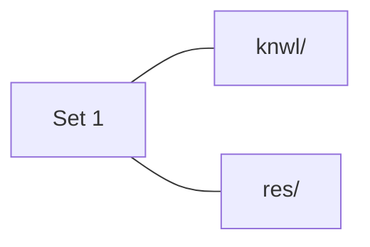
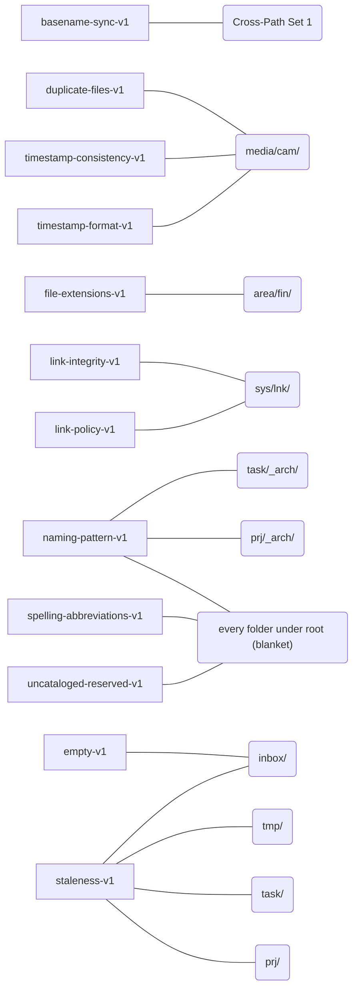

# usr - fs-org-std

> Generated from `fs-org-std.toml` - standard v1.0, schema v1.0

## Table of Contents

- [Overview](#section-overview)
- [Paths](#section-paths)
  - [`area/`](#path-area)
  - [`area/3dp/`](#path-area-3dp)
  - [`area/fin/`](#path-area-fin)
  - [`area/infra/`](#path-area-infra)
  - [`area/inv/`](#path-area-inv)
  - [`area/inv/item/`](#path-area-inv-item)
  - [`area/lrn/`](#path-area-lrn)
  - [`area/paper/`](#path-area-paper)
  - [`area/rc/`](#path-area-rc)
  - [`area/std/`](#path-area-std)
  - [`inbox/`](#path-inbox)
  - [`knwl/`](#path-knwl)
  - [`media/`](#path-media)
  - [`media/book/`](#path-media-book)
  - [`media/cam/`](#path-media-cam)
  - [`media/music/`](#path-media-music)
  - [`media/pic/`](#path-media-pic)
  - [`media/vid/`](#path-media-vid)
  - [`prj/`](#path-prj)
  - [`prj/_arch/`](#path-prj-arch)
  - [`res/`](#path-res)
  - [`strg/`](#path-strg)
  - [`strg/app/`](#path-strg-app)
  - [`strg/bkup/`](#path-strg-bkup)
  - [`strg/driver/`](#path-strg-driver)
  - [`strg/game/`](#path-strg-game)
  - [`strg/unk/`](#path-strg-unk)
  - [`sys/`](#path-sys)
  - [`sys/lnk/`](#path-sys-lnk)
  - [`sys/lnk/cur/`](#path-sys-lnk-cur)
  - [`sys/lnk/nav/`](#path-sys-lnk-nav)
  - [`sys/lnk/os/`](#path-sys-lnk-os)
  - [`sys/prog/`](#path-sys-prog)
  - [`sys/scr/`](#path-sys-scr)
  - [`sys/vm/`](#path-sys-vm)
  - [`task/`](#path-task)
  - [`task/_arch/`](#path-task-arch)
  - [`tmp/`](#path-tmp)
  - [`ws/`](#path-ws)
  - [`ws/lib/`](#path-ws-lib)
  - [`ws/tmpl/`](#path-ws-tmpl)
  - [`ws/tool/`](#path-ws-tool)
- [Cross-Path Sets](#section-cross)
  - [Set 1](#cross-1)
- [Reserved Folders](#section-folders)
  - [`_arch`](#folder-arch)
  - [`_unsorted`](#folder-unsorted)
  - [`_util`](#folder-util)
- [Rules](#section-rules)
  - [`basename-sync-v1`](#rule-basename-sync-v1)
  - [`duplicate-files-v1`](#rule-duplicate-files-v1)
  - [`empty-v1`](#rule-empty-v1)
  - [`file-extensions-v1`](#rule-file-extensions-v1)
  - [`link-integrity-v1`](#rule-link-integrity-v1)
  - [`link-policy-v1`](#rule-link-policy-v1)
  - [`naming-pattern-v1`](#rule-naming-pattern-v1)
  - [`spelling-abbreviations-v1`](#rule-spelling-abbreviations-v1)
  - [`staleness-v1`](#rule-staleness-v1)
  - [`timestamp-consistency-v1`](#rule-timestamp-consistency-v1)
  - [`timestamp-format-v1`](#rule-timestamp-format-v1)
  - [`uncataloged-reserved-v1`](#rule-uncataloged-reserved-v1)
- [Enums](#section-enums)
- [Abbreviations](#section-abbreviations)

## Overview

- **Root**: `~/usr/`
- Personal filesystem standard for ~/usr/ - a PARA-style split (area/prj/task/res/knwl) with state carried by folder location and `_`-prefixed reserved names.
- **Schema version**: 1.0 (2026-08-05)
- **Standard version**: 1.0 (2026-08-12)
- **Cataloged paths**: 42
- **Cross-path sets**: 1
- **Reserved folders**: 3

*(path hierarchy diagram skipped - 42 paths exceeds the 40-node readability limit)*

## Paths

### `area/`

| Field | Value |
|---|---|
| Purpose | Long-lived areas of responsibility, ownership, or interest. |
| Notes | Areas require maintenance but do not have a fixed completion date. If it can be finished, it is a project or a task. |
| Lifecycle | [`ongoing`](#section-enums) |
| Origin | `external`, `self` |
| See also | ['prj/', 'task/'] |

**Use for:**
- long-term responsibilities
- hobbies

**Not for:**
- storing referential materials
- projects or tasks

### `area/3dp/`

| Field | Value |
|---|---|
| Purpose | 3D printing hobby and its associated files. |
| Lifecycle | [`ongoing`](#section-enums) |
| Origin | `self`, `external`, `generated` |
| See also | ['prj/', 'knwl/'] |

**Use for:**
- printable models and print-related records
- 3D printing activity and results

**Not for:**
- active design projects
- general 3D printing knowledge

### `area/fin/`

| Field | Value |
|---|---|
| Purpose | Personal financial administration. |
| Lifecycle | [`ongoing`](#section-enums) |
| Origin | `self`, `external` |
| See also | ['area/paper/'] |

**Use for:**
- bank documents
- investment documents
- tax documents
- payslips
- invoices

**Not for:**
- shopping

**Attached rules:**

| Rule | Reason | Params |
|---|---|---|
| [`file-extensions-v1`](#rule-file-extensions-v1) | financial records must stay documents; anything else here arrived by accident | `allowed=["pdf", "xlsx"]` |

### `area/infra/`

| Field | Value |
|---|---|
| Purpose | Infrastructure documentation. |
| Notes | Separated by system. |
| Lifecycle | [`ongoing`](#section-enums) |
| Origin | `self` |
| See also | ['sys/'] |

**Use for:**
- documentation
- records
- documentation of how systems work together

**Not for:**
- files consumed by the system
- technical reference material

### `area/inv/`

| Field | Value |
|---|---|
| Purpose | Inventory of owned items. |
| Notes | Indexes describing collections of items. |
| Lifecycle | [`ongoing`](#section-enums) |
| Origin | `self`, `generated` |
| See also | ['area/inv/item/'] |

**Use for:**
- inventory indexes

**Not for:**
- reference materials unrelated to owned items
- shopping materials

### `area/inv/item/`

| Field | Value |
|---|---|
| Purpose | Information belonging to individual owned items. |
| Notes | Separated by item. |
| Lifecycle | [`ongoing`](#section-enums) |
| Origin | `external` |
| See also | ['area/inv/'] |

**Use for:**
- manuals
- warranties
- photos
- specifications
- configuration information

**Not for:**
- indexes of multiple items
- general items information

### `area/lrn/`

| Field | Value |
|---|---|
| Purpose | Active learning subjects. |
| Notes | Similar to projects, but the output is knowledge rather than a product. |
| Lifecycle | [`temporary`](#section-enums) |
| Origin | `self`, `external` |
| See also | ['res/', 'knwl/'] |

**Use for:**
- study notes
- exercises
- learning plans
- links to resources

**Not for:**
- finished distilled knowledge
- storing resources

### `area/paper/`

| Field | Value |
|---|---|
| Purpose | Official documents that are retained as records. |
| Lifecycle | [`ongoing`](#section-enums) |
| Origin | `external` |
| See also | ['area/fin/'] |

**Use for:**
- scanned documents
- electronic documents

**Not for:**
- unofficial documents
- actively managed domains

### `area/rc/`

| Field | Value |
|---|---|
| Purpose | RC hobby and its associated working material. |
| Notes | Should include links to RC related folders. |
| Lifecycle | [`ongoing`](#section-enums) |
| Origin | `self` |
| See also | ['prj/', 'res/', 'knwl/', 'area/inv/', 'media/cam/'] |

**Use for:**
- RC hobby activity and experiments
- RC-specific working material and test results

**Not for:**
- photos/videos related to RC
- personal firmware/PCB projects
- general technical material

### `area/std/`

| Field | Value |
|---|---|
| Purpose | Personal standards and conventions. |
| Notes | This file's own home. |
| Lifecycle | [`ongoing`](#section-enums) |
| Origin | `self` |
| See also | ['sys/scr/', 'area/infra/'] |

**Use for:**
- infrastructure conventions
- naming conventions
- workflow standards
- filesystem organization standards

**Not for:**
- configuration files
- transient notes
- documentation

### `inbox/`

| Field | Value |
|---|---|
| Purpose | Temporary location for files that have not yet been classified. |
| Notes | Files must eventually be moved to their final location, deleted, transformed into knowledge, or archived. |
| Lifecycle | [`transient`](#section-enums) |
| Origin | `external` |
| See also | ['tmp/', '_unsorted'] |

**Use for:**
- newly acquired files

**Not for:**
- permanent files

**Attached rules:**

| Rule | Reason | Params |
|---|---|---|
| [`empty-v1`](#rule-empty-v1) | a zero-byte file here is a failed transfer, not something waiting to be filed | `check_folders=false` |
| [`staleness-v1`](#rule-staleness-v1) | an arrival that survives a month in the inbox is being avoided, not triaged | `mode="stale"`, `threshold="1m"`, `destination="inbox/_unsorted"`, `exclude=["_*", ".*"]` |

### `knwl/`

| Field | Value |
|---|---|
| Purpose | Personal distilled knowledge. |
| Notes | Used with Obsidian. A completed note must not exist simultaneously with its source in res/ - enforced by the cross-path rule at the end of this section. |
| Lifecycle | [`ongoing`](#section-enums) |
| Origin | `self` |
| See also | ['res/', 'area/lrn/'] |

**Use for:**
- self-written notes
- distilled references
- personal cheat sheets
- processed external information

**Not for:**
- raw downloaded references
- manuals
- unprocessed documents

### `media/`

| Field | Value |
|---|---|
| Purpose | Entertainment media. |
| Lifecycle | [`ongoing`](#section-enums) |
| Origin | `self`, `external` |
| See also | ['res/'] |

**Use for:**
- leisure books
- downloaded videos
- pictures and wallpapers
- personal photos

**Not for:**
- technical literature
- video courses

### `media/book/`

| Field | Value |
|---|---|
| Purpose | Books intended for leisure reading. |
| Notes | Separated by genre. |
| Lifecycle | [`ongoing`](#section-enums) |
| Origin | `external` |
| See also | ['res/'] |

**Use for:**
- fiction
- popular science
- philosophy
- biographies

**Not for:**
- technical references
- manuals
- datasheets

### `media/cam/`

| Field | Value |
|---|---|
| Purpose | Personal photos and video. |
| Notes | Separated by year and optionally date. |
| Lifecycle | [`ongoing`](#section-enums) |
| Origin | `self`, `external` |
| See also | ['area/inv/item/'] |

**Use for:**
- personal photography
- personal videography

**Not for:**
- project photos
- inventory photos

**Attached rules:**

| Rule | Reason | Params |
|---|---|---|
| [`duplicate-files-v1`](#rule-duplicate-files-v1) | a re-imported card silently doubles the library; only content hashing finds it | `recursive=true`, `min_size=65536` |
| [`timestamp-consistency-v1`](#rule-timestamp-consistency-v1) | a photo filed under a date that contradicts its own name is lost, not misfiled | `recursive=true` |
| [`timestamp-format-v1`](#rule-timestamp-format-v1) | mixed date spellings in one tree break every sort and every range query over it | `formats=["%Y-%m-%d", "%Y%m%d_%H%M%S"]`, `target="both"` |

### `media/music/`

| Field | Value |
|---|---|
| Purpose | Music collection. |
| Notes | Separated primarily by artist. |
| Lifecycle | [`ongoing`](#section-enums) |
| Origin | `external` |

**Use for:**
- songs

**Not for:**
- sounds
- ringtones

### `media/pic/`

| Field | Value |
|---|---|
| Purpose | Pictures. |
| Lifecycle | [`ongoing`](#section-enums) |
| Origin | `external` |
| See also | ['media/cam/'] |

**Use for:**
- wallpapers
- pictures
- funny images

**Not for:**
- general personal photos
- general project photos

### `media/vid/`

| Field | Value |
|---|---|
| Purpose | Videos. |
| Lifecycle | [`ongoing`](#section-enums) |
| Origin | `external` |
| See also | ['media/cam/'] |

**Use for:**
- general videos
- ambient videos
- home theater demos

**Not for:**
- movies
- series
- courses
- personal videography

### `prj/`

| Field | Value |
|---|---|
| Purpose | Active projects. |
| Notes | A project is a transient effort which produces an outcome based on defined goals. |
| Lifecycle | [`temporary`](#section-enums) |
| Origin | `self` |
| See also | ['task/', 'prj/_arch/'] |

**Use for:**
- software/firmware projects
- PCB projects
- other multi-session efforts

**Not for:**
- small tasks
- reusable resources

**Attached rules:**

| Rule | Reason | Params |
|---|---|---|
| [`staleness-v1`](#rule-staleness-v1) | a project untouched for half a year is finished or abandoned; leaving it in prj/ hides the ones that aren't | `mode="stale"`, `threshold="6m"`, `destination="prj/_arch"`, `exclude=["_*", ".*"]` |

### `prj/_arch/`

| Field | Value |
|---|---|
| Purpose | Inactive projects. |
| Notes | Separated by year. |
| Lifecycle | [`archival`](#section-enums) |
| Origin | `self` |
| See also | ['prj/', '_arch'] |

**Use for:**
- completed projects
- abandoned projects
- paused projects
- obsolete projects

**Not for:**
- active projects
- backups

**Attached rules:**

| Rule | Reason | Params |
|---|---|---|
| [`naming-pattern-v1`](#rule-naming-pattern-v1) | the archive is only navigable while every folder at this level is a year | `pattern="^[0-9]{4}$"`, `mode="allow"`, `target="folders"`, `recursive=false` |

### `res/`

| Field | Value |
|---|---|
| Purpose | External knowledge materials. |
| Notes | Organized by subject. Must mirror knwl/'s structure. |
| Lifecycle | [`ongoing`](#section-enums) |
| Origin | `external` |
| See also | ['knwl/', 'area/lrn/'] |

**Use for:**
- datasheets
- application notes
- technical literature
- courses
- tutorials
- cheat-sheets

**Not for:**
- distilled knowledge
- device manuals
- project files

### `strg/`

| Field | Value |
|---|---|
| Purpose | Long-term storage for files that are rarely accessed but need to be preserved. |
| Lifecycle | [`archival`](#section-enums) |
| Origin | `self`, `external` |
| See also | ['sys/'] |

**Use for:**
- backups
- installers
- game saves

**Not for:**
- backup scripts
- game reference materials

### `strg/app/`

| Field | Value |
|---|---|
| Purpose | Application installers. |
| Notes | Separated by platform. |
| Lifecycle | [`archival`](#section-enums) |
| Origin | `external` |
| See also | ['sys/prog/'] |

**Use for:**
- applications
- games

**Not for:**
- installed applications/games
- application/games configuration
- game saves

### `strg/bkup/`

| Field | Value |
|---|---|
| Purpose | Recovery data. |
| Lifecycle | [`archival`](#section-enums) |
| Origin | `self`, `external` |
| See also | ['sys/scr/'] |

**Use for:**
- system backups
- device backups
- configuration backups
- binary dumps used for restoration

**Not for:**
- scripts
- active files

### `strg/driver/`

| Field | Value |
|---|---|
| Purpose | Hardware drivers. |
| Notes | Separated by platform. |
| Lifecycle | [`archival`](#section-enums) |
| Origin | `external` |
| See also | ['strg/app/'] |

**Use for:**
- vendor driver packages
- hardware support packages

**Not for:**
- applications
- hardware documentation

### `strg/game/`

| Field | Value |
|---|---|
| Purpose | Game saves. |
| Lifecycle | [`archival`](#section-enums) |
| Origin | `self` |
| See also | ['strg/app/'] |

**Use for:**
- saves

**Not for:**
- game reference
- game clips

### `strg/unk/`

| Field | Value |
|---|---|
| Purpose | Unknown files that might be important. |
| Notes | A holding pen, not a destination: anything identified here moves to where it belongs. |
| Lifecycle | [`archival`](#section-enums) |
| Origin | `external`, `generated` |
| See also | ['inbox/'] |

**Use for:**
- unknown encryption keys
- unknown binaries

**Not for:**
- files with known purpose

### `sys/`

| Field | Value |
|---|---|
| Purpose | Files consumed by this system and specific to it. |
| Lifecycle | [`ongoing`](#section-enums) |
| Origin | `self`, `external` |
| See also | ['area/infra/', 'ws/'] |

**Use for:**
- machine specific scripts
- virtual machines
- portable programs
- virtual views

**Not for:**
- project dependencies
- documentation

### `sys/lnk/`

| Field | Value |
|---|---|
| Purpose | Curated navigation spaces. |
| Notes | Nothing is stored here; every leaf points somewhere else. The two rules below apply to the whole subtree, so cur/, nav/ and os/ declare none of their own. |
| Lifecycle | [`ongoing`](#section-enums) |
| Origin | `self` |
| See also | ['sys/lnk/cur/', 'sys/lnk/nav/', 'sys/lnk/os/'] |

**Use for:**
- navigation links
- custom views of the filesystem

**Not for:**
- canonical file storage
- machine-specific files unrelated to navigation

**Attached rules:**

| Rule | Reason | Params |
|---|---|---|
| [`link-integrity-v1`](#rule-link-integrity-v1) | a dangling entry in a navigation space is worse than a missing one - it looks navigable | `recursive=true`, `follow_chains=true` |
| [`link-policy-v1`](#rule-link-policy-v1) | a real file in a navigation view is a file that exists only here, where nothing looks for it | `files="forbidden"`, `folders="allowed"`, `links="required"`, `recursive=true`, `exclude=[".*", "*/.*"]` |

### `sys/lnk/cur/`

| Field | Value |
|---|---|
| Purpose | Links to files and folders currently being worked on or used. |
| Notes | Contents change as current work and interests change. |
| Lifecycle | [`ongoing`](#section-enums) |
| Origin | `self`, `generated` |
| See also | ['prj/', 'task/', 'res/', 'knwl/'] |

**Use for:**
- current projects, tasks, and other work
- currently used books and resources

**Not for:**
- long-term navigation links

### `sys/lnk/nav/`

| Field | Value |
|---|---|
| Purpose | Curated navigation view of frequently accessed locations. |
| Notes | Organized for navigation rather than by the purpose of the linked files. |
| Lifecycle | [`ongoing`](#section-enums) |
| Origin | `self`, `generated` |
| See also | ['sys/lnk/cur/'] |

**Use for:**
- frequently accessed locations
- convenient groupings of locations

**Not for:**
- temporary current-work links

### `sys/lnk/os/`

| Field | Value |
|---|---|
| Purpose | Links to OS specific locations. |
| Lifecycle | [`ongoing`](#section-enums) |
| Origin | `self` |
| See also | ['area/infra/'] |

**Use for:**
- special OS locations with configuration files

**Not for:**
- general purpose OS locations

### `sys/prog/`

| Field | Value |
|---|---|
| Purpose | Installed programs. |
| Lifecycle | [`ongoing`](#section-enums) |
| Origin | `external` |
| See also | ['ws/tool/', 'strg/app/'] |

**Use for:**
- portable programs
- AppImages
- manually installed applications
- Wine prefixes

**Not for:**
- installers
- project tools

### `sys/scr/`

| Field | Value |
|---|---|
| Purpose | Machine-specific scripts. |
| Lifecycle | [`ongoing`](#section-enums) |
| Origin | `self`, `external` |
| See also | ['prj/', 'area/std/'] |

**Use for:**
- system helper scripts
- startup scripts
- maintenance scripts
- automation scripts

**Not for:**
- project scripts
- snippets

### `sys/vm/`

| Field | Value |
|---|---|
| Purpose | Virtual machines. |
| Lifecycle | [`ongoing`](#section-enums) |
| Origin | `external` |
| See also | ['strg/bkup/'] |

**Use for:**
- VM images
- VM configurations

**Not for:**
- VM backups

### `task/`

| Field | Value |
|---|---|
| Purpose | Small tasks with defined goals. |
| Notes | Tasks are smaller than projects in regards to effort and complexity. |
| Lifecycle | [`temporary`](#section-enums) |
| Origin | `self`, `external` |
| See also | ['prj/', 'task/_arch/'] |

**Use for:**
- writing scripts
- measurements
- investigations
- comparisons
- one-off activities

**Not for:**
- creating distilled knowledge
- complex scripts

**Attached rules:**

| Rule | Reason | Params |
|---|---|---|
| [`staleness-v1`](#rule-staleness-v1) | a task open for a quarter has outgrown being a task; archive it or promote it to a project | `mode="stale"`, `threshold="3m"`, `destination="task/_arch"`, `exclude=["_*", ".*"]` |

### `task/_arch/`

| Field | Value |
|---|---|
| Purpose | Inactive tasks. |
| Notes | Separated by year. |
| Lifecycle | [`archival`](#section-enums) |
| Origin | `self` |
| See also | ['task/', '_arch'] |

**Use for:**
- completed tasks
- abandoned tasks
- paused tasks
- obsolete tasks

**Not for:**
- active tasks

**Attached rules:**

| Rule | Reason | Params |
|---|---|---|
| [`naming-pattern-v1`](#rule-naming-pattern-v1) | the archive is only navigable while every folder at this level is a year | `pattern="^[0-9]{4}$"`, `mode="allow"`, `target="folders"`, `recursive=false` |

### `tmp/`

| Field | Value |
|---|---|
| Purpose | Transient files. |
| Notes | Separated by activity or collection. A sub-folder name may identify a deletion trigger. |
| Lifecycle | [`transient`](#section-enums) |
| Origin | `self`, `external`, `generated` |
| See also | ['inbox/', 'task/'] |

**Use for:**
- files that are known to be disposable
- temporary collections associated with an activity or event

**Not for:**
- files whose destination has not yet been decided
- files that may need to be retained indefinitely

**Attached rules:**

| Rule | Reason | Params |
|---|---|---|
| [`staleness-v1`](#rule-staleness-v1) | a file declared disposable a month ago and still here was never actually decided about | `mode="stale"`, `threshold="1m"`, `destination="inbox"`, `exclude=["_*", ".*"]` |

### `ws/`

| Field | Value |
|---|---|
| Purpose | Reusable assets and building blocks. |
| Notes | Primarily for projects, but not specific to one project. |
| Lifecycle | [`ongoing`](#section-enums) |
| Origin | `self`, `external` |
| See also | ['prj/', 'sys/'] |

**Use for:**
- libraries and SDKs
- development tools
- templates

**Not for:**
- project-specific dependencies

### `ws/lib/`

| Field | Value |
|---|---|
| Purpose | Libraries and dependencies. |
| Lifecycle | [`ongoing`](#section-enums) |
| Origin | `self`, `external` |
| See also | ['prj/'] |

**Use for:**
- reusable libraries
- vendor libraries
- SDKs

**Not for:**
- frozen dependencies
- project-specific libraries

### `ws/tmpl/`

| Field | Value |
|---|---|
| Purpose | Reusable starting points. |
| Lifecycle | [`ongoing`](#section-enums) |
| Origin | `self`, `external` |
| See also | ['prj/'] |

**Use for:**
- project templates
- configuration templates

**Not for:**
- projects
- directly usable files

### `ws/tool/`

| Field | Value |
|---|---|
| Purpose | Tools that support projects. |
| Lifecycle | [`ongoing`](#section-enums) |
| Origin | `self`, `external` |
| See also | ['sys/prog/'] |

**Use for:**
- development utilities
- helper programs
- CLI tools

**Not for:**
- general applications

## Cross-Path Sets

### Set 1

**Members**: [`knwl/`](#path-knwl), [`res/`](#path-res)

**Attached rules:**

| Rule | Reason | Params |
|---|---|---|
| [`basename-sync-v1`](#rule-basename-sync-v1) | source material that has been completely distilled must be removed; a name in both halves means it wasn't | `mode="exclusive"`, `recursive=true` |

## Reserved Folders

Reserved-name prefix: `_`

### `_arch`

| Field | Value |
|---|---|
| Purpose | Archive of inactive information/containers. |
| Notes | Indicates that contents are no longer part of the active workflow. Exception to the principle of tagging state rather than moving things. |
| Lifecycle | [`archival`](#section-enums) |
| Origin | `self`, `external` |
| See also | ['prj/_arch/', 'task/_arch/', 'strg/'] |

**Use for:**
- projects/tasks that are no longer active
- domains that are no longer maintained
- non-versioned but obsolete files

**Not for:**
- general archival
- backups

### `_unsorted`

| Field | Value |
|---|---|
| Purpose | Local unsorted files. |
| Notes | Files that belong under the parent directory but need additional classification. Unlike inbox/, the destination is already known - only the shelf isn't. |
| Lifecycle | [`transient`](#section-enums) |
| Origin | `self`, `external` |
| See also | ['inbox/', 'tmp/'] |

**Use for:**
- files awaiting classification
- transient holding area during organization
- files returned from original organization

**Not for:**
- general transient files
- long-term storage
- archived information

### `_util`

| Field | Value |
|---|---|
| Purpose | Frequently used utilities related to the parent directory. |
| Notes | Contains links to utilities that are commonly used with the parent directory. |
| Lifecycle | [`ongoing`](#section-enums) |
| Origin | `self`, `external` |
| See also | ['sys/scr/', 'sys/prog/', 'ws/tool/'] |

**Use for:**
- links to applications
- scripts
- directory-specific workflows

**Not for:**
- general applications
- general scripts
- installers

## Rules

### `basename-sync-v1`

Checks whether 2+ paths agree on which files exist by name (ignoring or comparing extensions) - e.g. a lossless library that should have a matching lossy mirror, or a not-processed/processed pair where the source should disappear once processed.

| | |
|---|---|
| Tier | bundled |
| Version | 1.0 |
| Severity | `warn` |
| Scope | `cross` |
| Fixable | yes |

**Params:**

| Name | Default | Required |
|---|---|---|
| `mode` |  | yes |
| `recursive` | `true` | no |
| `extensions` | `[]` | no |
| `exclude` | `[]` | no |
| `fixer_script` | `""` | no |

**Attached at 1 location(s):**

- [`Cross-Path Set 1`](#cross-1) - source material that has been completely distilled must be removed; a name in both halves means it wasn't

### `duplicate-files-v1`

Finds byte-identical files by content hash - either within a single path (scope=single) or only across the given paths (scope=cross), e.g. the same photo sitting in both an inbox and its filed destination. Hashes are cached on disk and reused until a file's size or mtime changes.

| | |
|---|---|
| Tier | bundled |
| Version | 1.0 |
| Severity | `warn` |
| Scope | `both` |
| Fixable | no |

**Params:**

| Name | Default | Required |
|---|---|---|
| `recursive` | `true` | no |
| `extensions` | `[]` | no |
| `exclude` | `[]` | no |
| `min_size` | `1` | no |
| `algorithm` | `"blake2b"` | no |
| `cache` | `true` | no |
| `cache_ttl_days` | `30` | no |

**Attached at 1 location(s):**

- [`media/cam/`](#path-media-cam) - a re-imported card silently doubles the library; only content hashing finds it

### `empty-v1`

Reports zero-byte files and empty folders under a path - leftovers from an interrupted download, a failed export, or a folder whose contents were moved out and never cleaned up.

| | |
|---|---|
| Tier | bundled |
| Version | 1.0 |
| Severity | `warn` |
| Scope | `single` |
| Fixable | no |

**Params:**

| Name | Default | Required |
|---|---|---|
| `check_files` | `true` | no |
| `check_folders` | `true` | no |
| `recursive` | `true` | no |
| `exclude` | `[]` | no |
| `folder_empty_means` | `"no_entries"` | no |

**Attached at 1 location(s):**

- [`inbox/`](#path-inbox) - a zero-byte file here is a failed transfer, not something waiting to be filed

### `file-extensions-v1`

Checks that every file under the path has an allowed extension, or does not have a disallowed one - exactly one of the two lists is used per attachment.

| | |
|---|---|
| Tier | bundled |
| Version | 1.0 |
| Severity | `warn` |
| Scope | `single` |
| Fixable | no |

**Params:**

| Name | Default | Required |
|---|---|---|
| `allowed` | `[]` | no |
| `disallowed` | `[]` | no |
| `recursive` | `true` | no |
| `exclude` | `[]` | no |

**Attached at 1 location(s):**

- [`area/fin/`](#path-area-fin) - financial records must stay documents; anything else here arrived by accident

### `link-integrity-v1`

Reports links whose target no longer exists - symlinks, XDG .desktop entries, Windows .lnk/.url shortcuts, and macOS .webloc bookmarks.

| | |
|---|---|
| Tier | bundled |
| Version | 1.0 |
| Severity | `warn` |
| Scope | `single` |
| Fixable | no |

**Params:**

| Name | Default | Required |
|---|---|---|
| `kinds` | `["symlink", "desktop", "shortcut", "webloc"]` | no |
| `recursive` | `true` | no |
| `exclude` | `[]` | no |
| `foreign_links` | `"skip"` | no |
| `follow_chains` | `true` | no |

**Attached at 1 location(s):**

- [`sys/lnk/`](#path-sys-lnk) - a dangling entry in a navigation space is worse than a missing one - it looks navigable

### `link-policy-v1`

Constrains which kinds of entry may appear under a path - real files, folders, and links each independently required, allowed, or forbidden.

| | |
|---|---|
| Tier | bundled |
| Version | 1.0 |
| Severity | `warn` |
| Scope | `single` |
| Fixable | no |

**Params:**

| Name | Default | Required |
|---|---|---|
| `files` | `"allowed"` | no |
| `folders` | `"allowed"` | no |
| `links` | `"allowed"` | no |
| `link_kinds` | `["symlink", "desktop", "shortcut", "webloc"]` | no |
| `recursive` | `false` | no |
| `exclude` | `[]` | no |

**Attached at 1 location(s):**

- [`sys/lnk/`](#path-sys-lnk) - a real file in a navigation view is a file that exists only here, where nothing looks for it

### `naming-pattern-v1`

Checks file and/or folder names against a regular expression - either every name must match it (allow), or no name may match it (disallow).

| | |
|---|---|
| Tier | bundled |
| Version | 1.0 |
| Severity | `warn` |
| Scope | `single` |
| Fixable | no |

**Params:**

| Name | Default | Required |
|---|---|---|
| `pattern` |  | yes |
| `mode` |  | yes |
| `target` | `"both"` | no |
| `recursive` | `true` | no |
| `exclude` | `[]` | no |

**Attached at 3 location(s):**

- `every folder under root (blanket)` - a name that can't survive a copy to a FAT-formatted drive fails silently, years after it was written
- [`prj/_arch/`](#path-prj-arch) - the archive is only navigable while every folder at this level is a year
- [`task/_arch/`](#path-task-arch) - the archive is only navigable while every folder at this level is a year

### `spelling-abbreviations-v1`

Checks that words in file/folder names are either spelled correctly or are known abbreviations - catches typos and undocumented shorthand before they spread across a tree.

| | |
|---|---|
| Tier | bundled |
| Version | 1.0 |
| Severity | `warn` |
| Scope | `single` |
| Fixable | no |

**Params:**

| Name | Default | Required |
|---|---|---|
| `abbreviations` |  | yes |
| `languages` | `["en"]` | no |
| `min_word_length` | `3` | no |
| `ignore` | `[]` | no |
| `numbers_ok` | `true` | no |
| `target` | `"both"` | no |
| `recursive` | `true` | no |
| `exclude` | `[]` | no |

**Attached at 1 location(s):**

- `every folder under root (blanket)` - folder names are the standard's vocabulary; an undeclared shorthand today is an inconsistent one next year

### `staleness-v1`

Checks each direct child of a path against an age threshold - either flagging things that have gone stale (mode="stale", for active folders that should stay current) or things that are unexpectedly active (mode="active", for archive folders that shouldn't be seeing new activity).

| | |
|---|---|
| Tier | bundled |
| Version | 1.0 |
| Severity | `warn` |
| Scope | `single` |
| Fixable | yes |

**Params:**

| Name | Default | Required |
|---|---|---|
| `mode` |  | yes |
| `threshold` |  | yes |
| `basis` | `"mtime"` | no |
| `destination` |  | yes |
| `exclude` | `[]` | no |

**Attached at 4 location(s):**

- [`inbox/`](#path-inbox) - an arrival that survives a month in the inbox is being avoided, not triaged
- [`prj/`](#path-prj) - a project untouched for half a year is finished or abandoned; leaving it in prj/ hides the ones that aren't
- [`task/`](#path-task) - a task open for a quarter has outgrown being a task; archive it or promote it to a project
- [`tmp/`](#path-tmp) - a file declared disposable a month ago and still here was never actually decided about

### `timestamp-consistency-v1`

Checks that a file or folder's embedded timestamp is consistent with the timestamps embedded in its ancestor folder names - a file dated 2026-03-06 inside a 2026-03-05 folder is a contradiction, even though both are individually valid dates.

| | |
|---|---|
| Tier | bundled |
| Version | 1.0 |
| Severity | `error` |
| Scope | `single` |
| Fixable | no |

**Params:**

| Name | Default | Required |
|---|---|---|
| `recursive` | `true` | no |
| `require_all_components_timestamped` | `false` | no |

**Attached at 1 location(s):**

- [`media/cam/`](#path-media-cam) - a photo filed under a date that contradicts its own name is lost, not misfiled

### `timestamp-format-v1`

Checks that any name whose leading characters form a real calendar date or datetime uses one of the standard's accepted formats - a name with no such leading timestamp at all is left alone, not flagged.

| | |
|---|---|
| Tier | bundled |
| Version | 1.0 |
| Severity | `warn` |
| Scope | `single` |
| Fixable | no |

**Params:**

| Name | Default | Required |
|---|---|---|
| `formats` |  | yes |
| `target` | `"both"` | no |
| `recursive` | `true` | no |
| `exclude` | `[]` | no |

**Attached at 1 location(s):**

- [`media/cam/`](#path-media-cam) - mixed date spellings in one tree break every sort and every range query over it

### `uncataloged-reserved-v1`

Checks for folders that use the standard's reserved-name prefix (e.g. "_") but aren't cataloged under [folders.reserved."..."] - a folder that LOOKS reserved but isn't documented.

| | |
|---|---|
| Tier | bundled |
| Version | 1.0 |
| Severity | `warn` |
| Scope | `single` |
| Fixable | no |

**Params:**

| Name | Default | Required |
|---|---|---|
| `prefix` | `"_"` | no |
| `cataloged` |  | yes |
| `recursive` | `true` | no |
| `exclude` | `[]` | no |

**Attached at 1 location(s):**

- `every folder under root (blanket)` - a folder that looks reserved but isn't documented is an undeclared convention spreading through the tree

## Enums

**Lifecycle:**

| Value | Meaning |
|---|---|
| `transient` | meant to be emptied constantly, nothing lingers |
| `temporary` | has a completion condition, then gets archived |
| `ongoing` | continuously active/maintained, no end state |
| `archival` | already at rest, rarely touched |

**Origin:**

| Value | Meaning |
|---|---|
| `self` | authored directly by you - nothing to re-fetch or resync from elsewhere |
| `external` | sourced from outside this system - downloaded, received, or otherwise not authored by you |
| `generated` | produced automatically by a tool, script, or model - not hand-authored, not fetched externally |

## Abbreviations

| Abbreviation | Meaning |
|---|---|
| `3dp` | 3D printing |
| `app` | Application |
| `arch` | Archive |
| `area` | Area of responsibility |
| `bkup` | Backup |
| `cam` | Camera |
| `cur` | Current |
| `embd` | Embedded |
| `fin` | Finance |
| `fw` | Firmware |
| `infra` | Infrastructure |
| `inv` | Inventory |
| `item` | Individual owned item |
| `knwl` | Knowledge |
| `lib` | Library |
| `lnk` | Link |
| `lrn` | Learn |
| `med` | Medical |
| `nav` | Navigation |
| `ndx` | Index |
| `pic` | Picture |
| `prj` | Project |
| `prog` | Program |
| `rc` | Radio control |
| `res` | Resource |
| `scr` | Script |
| `std` | Standard |
| `strg` | Storage |
| `sys` | System |
| `task` | Task |
| `tmp` | Temporary |
| `tmpl` | Template |
| `tool` | Tool |
| `unk` | Unknown |
| `util` | Utility |
| `vid` | Video |
| `vm` | Virtual machine |
| `ws` | Workspace |

